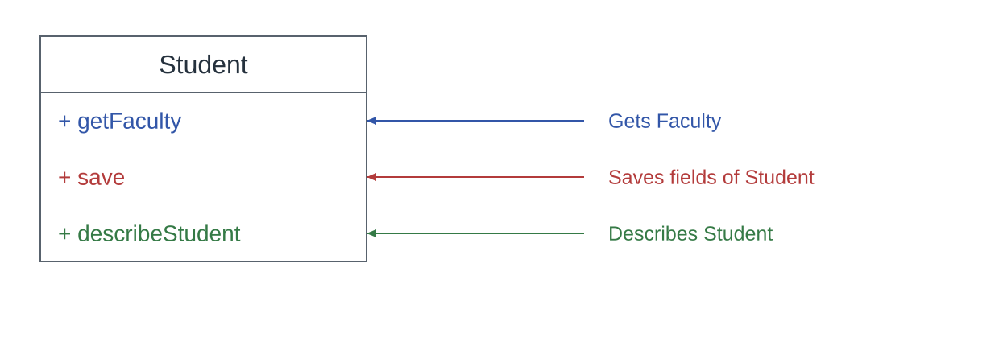
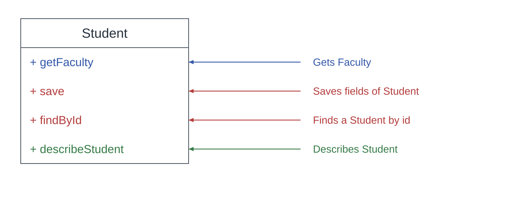
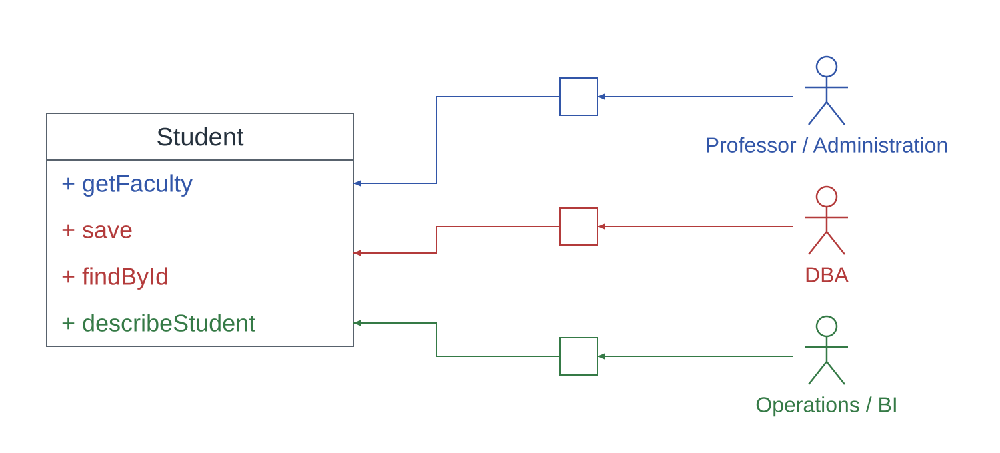
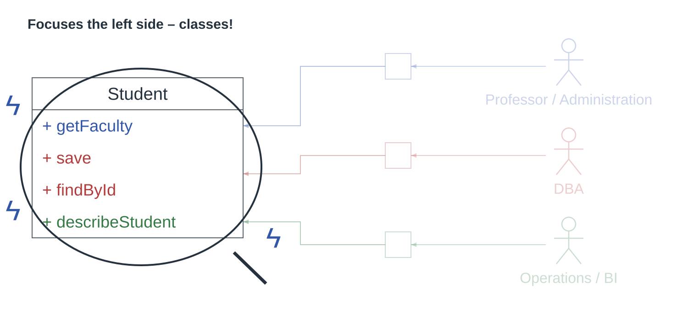
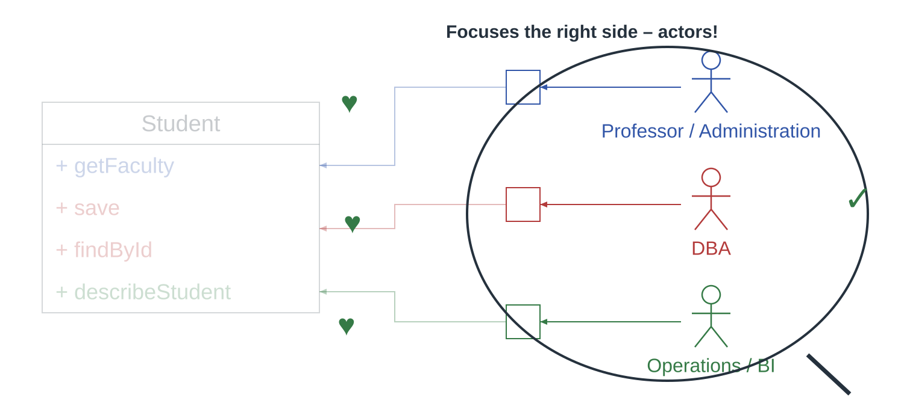
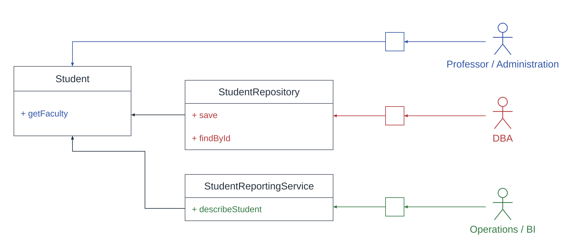

<!-- _class: cover -->

# Single Ownership Principle
## Understanding SRP through Student and three more examples
Nodirbek Usmanov

[linkedin.com/in/nodirbek-usmanov](https://linkedin.com/in/nodirbek-usmanov)  
[nodirbek@befico.de](mailto:nodirbek@befico.de)

---

<!-- _class: quote -->

# Single Responsibility Principle (SRP)

> “A class should have only one reason to change.”

Robert C. Martin, 2002

---

<!-- _class: quote -->

# SRP: Martin's clarification in 2014

> “Each software module should have one and only one reason to change.”

Robert C. Martin, 2014

The reason comes from people representing a narrowly defined business function.

---

<!-- _class: diagram -->

# How many responsibilities?

Think of a reason to change, not a method count.

---

<!-- _class: diagram -->

# Add `findById`. What changes?

Four methods. How many independent reasons to change?

---

<!-- _class: diagram tight -->

# Who asks for these changes?

---

# Three change sources, four methods

- **Professor / Administration:** `getFaculty`
- **DBA:** `save` and `findById`
- **Operations / BI:** `describeStudent`

`save` and `findById` count together **if the same storage policy drives changes to both**.

---

# One responsibility can contain several functions

In this scenario, `save` and `findById` form **one family of functions** if one actor sets the storage policy for both.

`getFaculty` and `describeStudent` answer to different actors. They can change for different reasons.

**To place a new method, ask whose requirements will make it change.**

---

<!-- _class: diagram highlight -->

# SRP: focus on the class

One Student class must change for three independent groups.

---

# What is an owner here?

**Owner (in SOP):** the actor whose requirements define one narrowly scoped business function.

An actor is a **role**, not a headcount. One person may play several roles; one team may support several actors.

In this example, the proposed owners are Professor / Administration, DBA, and Operations / BI.

---

<!-- _class: diagram highlight -->

# SOP: focus on the owners

Which independent group can ask this class to change?

---

<!-- _class: quote -->

# Single Ownership Principle (SOP)

> “A class should answer to one owner whose requirements drive its changes.”

Nodirbek Usmanov, 2023

---

# SRP and SOP find the same boundary

<h2>SRP asks</h2>
<blockquote>How many independent reasons can change this class?</blockquote>

Student has three in this example.

<h2>SOP asks</h2>
<blockquote>Who can independently request those changes?</blockquote>

Student serves three proposed owners in this example.

Martin calls the change-driving role an actor; SOP calls it an owner. Both identify the same boundary.

---

<!-- _class: diagram refactor -->

# Separate the responsibilities

Keep together what changes for the same reason; separate what changes for different reasons.

---

# A necessary check before splitting

- `save` and `findById` do **not** belong together merely because both access a database.
- Ask whether one storage policy really drives changes to both methods.
- Check whether DBA and Operations / BI specify behavior, or only help implement it.
- Check dependencies after the split: a change to shared `Student` may still affect the other classes.

The actor map is a **hypothesis to verify**, not proof from the method names.

---

<!-- _class: example -->

# Example 1 — Employee

Assumption: pay, storage and description policies change independently.

<h2>Employee class</h2>
<ul><li><code>CalculatePay</code></li><li><code>Save</code></li><li><code>DescribeEmployee</code></li></ul>

<h2>SRP</h2>

Pay rules, record retention and employee descriptions can change independently.

Violated: three reasons to change.

<h2>SOP</h2>

Payroll, DBA and Operations / BI can each request changes.

Violated: three owners.

<!--
Presenter prompt: Suppose Employee gains SummarizeHoursWorked. Ask the audience who would request changes to it. Its actor, not its name, determines which family of functions it belongs to.
-->

---

<!-- _class: example -->

# Example 2 — Invoice

Assumption: tax, PDF design and archiving policies change independently.

<h2>Invoice class</h2>
<ul><li><code>CalculateTax</code></li><li><code>GeneratePdf</code></li><li><code>Archive</code></li></ul>

<h2>SRP</h2>

Tax law, PDF branding and retention rules change independently.

Violated: three reasons to change.

<h2>SOP</h2>

Tax, Billing Design and Records can each request changes.

Violated: three owners.

---

<!-- _class: example -->

# Example 3 — UserAccount

Assumption: all three methods follow one authentication policy.

<h2>UserAccount class</h2>
<ul><li><code>VerifyPassword</code></li><li><code>ChangePassword</code></li><li><code>ResetPassword</code></li></ul>

<h2>SRP</h2>

All three methods change with the same authentication policy.

Satisfied: one reason to change.

<h2>SOP</h2>

Identity Security defines this one policy.

Satisfied: one owner.

---

<!-- _class: takeaway -->

# Take away

- The number of methods does not determine the number of responsibilities.
- **SRP:** Does the class have one reason to change?
- **SOP:** Does it serve one owner of that responsibility?
- Count narrowly defined requirement sources, not broad platform teams. Then both identify the same boundary.

---

<!-- _class: links -->

# Sources

- [The Single Responsibility Principle](https://blog.cleancoder.com/uncle-bob/2014/05/08/SingleReponsibilityPrinciple.html)  
  Robert C. Martin, 8 May 2014
- *Agile Software Development: Principles, Patterns, and Practices*  
  Robert C. Martin, 2002
- *Clean Architecture: A Craftsman's Guide to Software Structure and Design*  
  Robert C. Martin, 2017

---

# Thank you

Contact me

<a href="https://linkedin.com/in/nodirbek-usmanov">linkedin.com/in/nodirbek-usmanov</a>

<a href="mailto:nodirbek@befico.de">nodirbek@befico.de</a>

Reviewer Ulugbek Usmanov

Adesso AG Deutschland

Reviewer Marcus Schroeder

flint &amp; sparks GmbH, Berlin

