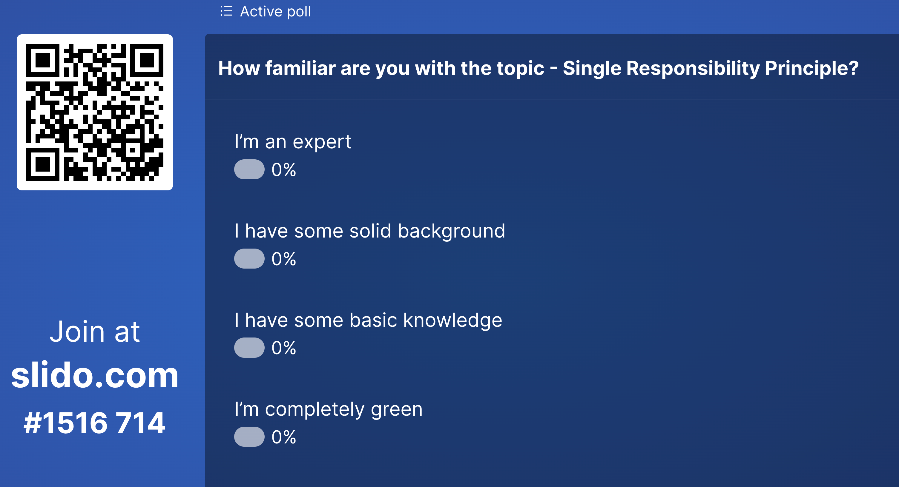
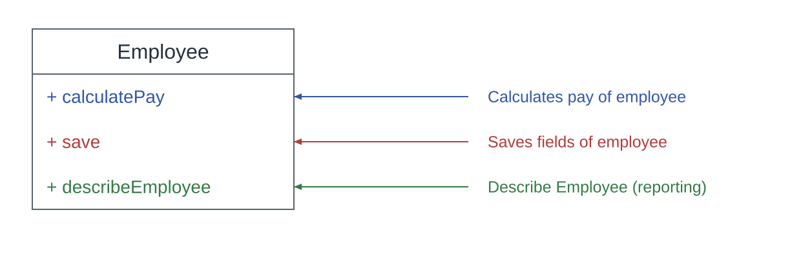
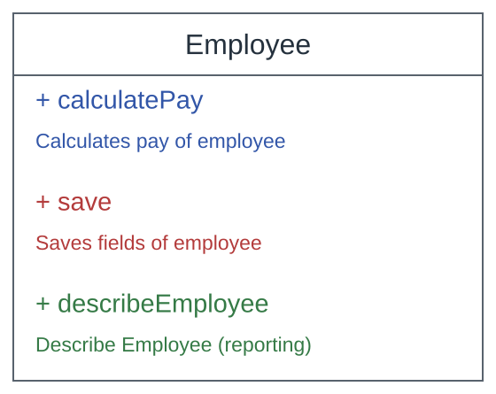
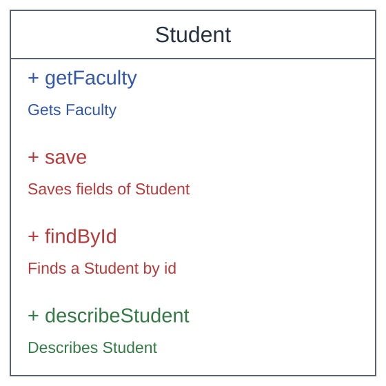

<!-- _class: cover -->

# Single Responsibility Principle
## Misunderstood and underestimated
Nodirbek Usmanov

[linkedin.com/in/nodirbek-usmanov](https://linkedin.com/in/nodirbek-usmanov)  
[nodirbek@befico.de](mailto:nodirbek@befico.de)

<!--
Source: original slide 1. Original title spelling: MiSSUnDERSTOOD. Embedded icons are preserved in assets/image3.svg and assets/image4.svg.
-->

---

<!-- _class: diagram -->

# Intro

<!--
Original Slido poll screenshot is preserved unchanged, including its historic QR code and poll number.
-->

---

<!-- _class: quote -->

# Single Responsibility Principle

> “A class should have only one reason to change.”

Robert C. Martin Agile Software Development: Principles, Patterns, and Practices, 2002

---

<!-- _class: photo -->

# Single Responsibility Principle

## Is one of the simplest of the principles, and one of the hardest to get

---

<!-- _class: quote -->

# Single Responsibility Principle (SRP)

> “In context of SRP, we define a responsibility to be a reason for change.”

Robert C. Martin Agile Software Development: Principles, Patterns, and Practices, 2002

---

<!-- _class: quote -->

# Single Responsibility Principle (SRP) is about people

> “...a single tightly coupled group of people representing a single narrowly defined business function...”

Robert C. Martin “The Single Responsibility Principle,” 8 May 2014

---

<!-- _class: actor-owner -->

# Actor and owner are not automatically the same

<h2>SRP · Actor</h2>

Whose needs trigger a change?

IN THE INVOICE MODULE

<strong>Tax team</strong> requests changes to tax calculations.

<strong>Brand team</strong> requests changes to the PDF layout.

<h2>SOP · Owner</h2>

Who is accountable for deciding, prioritizing, and accepting changes?

OWNER OF THE INVOICE MODULE

Billing Platform team

Prioritizes both requests and is accountable for the module.

<strong>SRP asks where changes come from. SOP asks who is accountable.</strong> One owner may coordinate several actors; ownership alone does not decide whether code belongs in one class.

---

<!-- _class: diagram -->

# Single Responsibility Principle

“A class should have only one reason to change.” — Robert C. Martin

<!--
Original PowerPoint: off-slide code (not visible in the source slide).

class OrderService {
    fun sendEmail (): = { … }
    fun findById (): Order = { … }
    fun generateInvoice (): Invoice = { … }}
-->

---

<!-- _class: diagram -->

# Responsibility

How many responsibilities does this class have?

<!--
Original PowerPoint: off-slide code (not visible in the source slide).

class OrderService {
    fun sendEmail (): = { … }
    fun findById (): Order = { … }
    fun generateInvoice (): Invoice = { … }}
-->

---

<!-- _class: diagram -->

# Responsibility

How many responsibilities does this class have?  **3**

<!--
Original PowerPoint: off-slide code (not visible in the source slide).

class OrderService {
    fun sendEmail (): = { … }
    fun findById (): Order = { … }
    fun generateInvoice (): Invoice = { … }}
-->

---

# Conclusion – violates SRP

The class knows about

<ul><li>business rules</li><li>databases</li><li>reports and formatting</li></ul>

<strong>Responsibilities &gt; 1</strong>

Each of these responsibilities will cause the employee class to use other classes in the system.

<!--
Original PowerPoint: off-slide code (not visible in the source slide).

class OrderService {
    fun sendEmail (): = { … }
    fun findById (): Order = { … }
    fun generateInvoice (): Invoice = { … }}
-->

---

<!-- _class: diagram -->

# Responsibility

How many responsibilities does this class have?

<!--
Original PowerPoint: off-slide code (not visible in the source slide).

class OrderService {
    fun sendEmail (): = { … }
    fun findById (): Order = { … }
    fun generateInvoice (): Invoice = { … }}
-->

---

<!-- _class: diagram -->

# Responsibility

How many responsibilities does this class have?  **3**

<!--
Original PowerPoint: off-slide code (not visible in the source slide).

class OrderService {
    fun sendEmail (): = { … }
    fun findById (): Order = { … }
    fun generateInvoice (): Invoice = { … }}
-->

---

<!-- _class: diagram tight -->

# Responsibility

Let us add a new function to the class.  
How many responsibilities does this class have?

**+ findById** — Finds a student by id

<!--
Original PowerPoint: off-slide code (not visible in the source slide).

class OrderService {
    fun sendEmail (): = { … }
    fun findById (): Order = { … }
    fun generateInvoice (): Invoice = { … }}
Original slide included an arrow pointing to the diagram.
-->

---

<!-- _class: diagram tight -->

# Responsibility

How many responsibilities does this class have? **3**

Same family as save, both database functions

<!--
Original PowerPoint: off-slide code (not visible in the source slide).

class OrderService {
    fun sendEmail (): = { … }
    fun findById (): Order = { … }
    fun generateInvoice (): Invoice = { … }}
-->

---

# Conclusion – violates SRP

The class knows about

<ul><li>business rules</li><li>databases</li><li>reports and formatting</li></ul>

<strong>Responsibilities &gt; 1</strong>

Each of these responsibilities will cause the student class to use other classes in the system.

<!--
Original PowerPoint: off-slide code (not visible in the source slide).

class OrderService {
    fun sendEmail (): = { … }
    fun findById (): Order = { … }
    fun generateInvoice (): Invoice = { … }}
-->

---

<!-- _class: takeaway -->

# Responsibility – source of change

## The SRP is about users

Who are the users, who add changes to that method?

<!--
Original PowerPoint: off-slide code (not visible in the source slide).

class OrderService {
    fun sendEmail (): = { … }
    fun findById (): Order = { … }
    fun generateInvoice (): Invoice = { … }}
-->

---

<!-- _class: diagram -->

# Responsibility

Who are the people, who are the sources of change for the STUDENT class?

<!--
Original PowerPoint: off-slide code (not visible in the source slide).

class OrderService {
    fun sendEmail (): = { … }
    fun findById (): Order = { … }
    fun generateInvoice (): Invoice = { … }}
-->

---

<!-- _class: diagram highlight -->

# Single Responsibility Principle

“A class should have only one reason to change.” — Robert C. Martin

<!--
Original PowerPoint: off-slide code (not visible in the source slide).

class OrderService {
    fun sendEmail (): = { … }
    fun findById (): Order = { … }
    fun generateInvoice (): Invoice = { … }}
Editable draw.io diagram: diagrams/student-class-focus.drawio.
-->

---

<!-- _class: diagram highlight -->

# Single Responsibility Principle

Responsibility is a family of functions that serves one particular actor

<!--
Original PowerPoint: off-slide code (not visible in the source slide).

class OrderService {
    fun sendEmail (): = { … }
    fun findById (): Order = { … }
    fun generateInvoice (): Invoice = { … }}
Editable draw.io diagram: diagrams/student-actor-focus.drawio.
-->

---

# Rephrase

<h2>Single Responsibility Principle</h2>
<blockquote>“A class should have only one reason to change.”</blockquote>

Robert C. Martin, 2002

<h2>Single Ownership Principle</h2>
<blockquote>“A class should serve only one owner, who defines the requirements to create or change it.”</blockquote>

Nodirbek Usmanov, 2023

---

# Rephrase 2

<h2>Single Responsibility Principle</h2>
<blockquote>“A class should have only one reason to change.”</blockquote>

Robert C. Martin, 2002

<h2>Single Ownership Principle</h2>
<blockquote>“A class should serve only one owner, who defines a family of functions (responsibility).”</blockquote>

Nodirbek Usmanov, 2023

---

<!-- _class: diagram refactor -->

# Refactor

Aware of transitive dependencies

<!--
Original PowerPoint: off-slide code (not visible in the source slide).

class OrderService {
    fun sendEmail (): = { … }
    fun findById (): Order = { … }
    fun generateInvoice (): Invoice = { … }}
-->

---

<!-- _class: takeaway -->

# Take away

- A responsibility is a family of functions that serves one particular actor
- Increase the cohesion between things that change for same reasons
- Decrease the coupling between those things that change for different reasons

<!--
Source contains a repeated word: “change change”. The repetition was removed.
-->

---

<!-- _class: links -->

# Links

- [The Single Responsibility Principle](https://blog.cleancoder.com/uncle-bob/2014/05/08/SingleReponsibilityPrinciple.html)  
  Robert C. Martin (Uncle Bob), 8 May 2014
- *Agile Software Development: Principles, Patterns, and Practices*  
  Robert C. Martin (Uncle Bob), 2002

---

# Thank you

Reviewer Ulugbek Usmanov

Adesso AG Deutschland

Reviewer Marcus Schroeder

flint &amp; sparks GmbH, Berlin

Contact me

<a href="https://linkedin.com/in/nodirbek-usmanov">linkedin.com/in/nodirbek-usmanov</a>

<a href="mailto:nodirbek@befico.de">nodirbek@befico.de</a>

